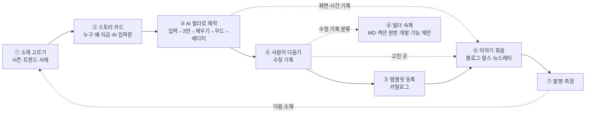

# 4-15. 시즌 템플릿 루프 — AI 빌더로 만들고, 이야기로 알리고, 빌더를 키운다

> 🎯 **한 줄** — **매주 한 번**, 그 시기에 맞는 소재(명절·연말·트렌드)로 **AI 빌더가 템플릿을 만들고 사람이 다듬어 등록**한다. 만드는 과정을 전부 기록해 **템플릿마다 다른 이야기**로 알리고, 사람이 고친 곳은 **빌더의 숙제**로 넘긴다.
> 🔁 **원리 = 한 번 만들고 세 번 쓴다** — ① 카탈로그 템플릿 ② 마케팅 이야기 ③ 빌더 개선 재료.
> 📌 **상태 = 초안.** 승인 전에는 파일럿 2건만 돌린다 → [[#12. 정해 주셔야 할 것]].

---

## 0. 결론 먼저 — 6줄

1. **주기** = ✅ **주 1회 — 매주 목요일 발행**(2026-10-29). 이야기는 매주 나가고, **신규 템플릿 등록은 「새 것」·품질 관문을 넘는 주만** 한다(개수 때문에 기준을 낮추지 않는다). 월 1회 계획(승인 30분)으로 4~5회차를 미리 정한다.
2. **소재** = 4개월 앞 시즌 달력 + 트렌드 + 기존 사례 풀에서 고른다(템플릿은 이벤트 **3~8주 전**에 나와야 한다 · §3-3). 회차마다 **「이번에만 있는 새 것」 1개**(새 섹션·새 기능·처음 다루는 주제)가 있어야 신규 템플릿으로 낸다 — 없으면 기존 템플릿 활용 글로 돌린다.
3. **제작** = AI 빌더 실제 플로우를 처음부터 끝까지 돌린다(자동화 이미 있음). 사람이 다듬은 곳은 **「수정 기록」**으로 남긴다.
4. **이야기** = 채널 3개(✅ 2026-10-29 확정) — **블로그** 새 시리즈 **「AI 빌더 제작기 #N」** 1편이 중심 → **인스타 릴스**(회차마다) · **뉴스레터**(매달 중순 「다음 달 시즌 준비」)로 보낸다. **「AI가 만들었다」를 제목·첫 화면에서 가장 크게**(템플릿 상세 페이지엔 표시 ❌). **숫자는 잰 것만, 가상 인물은 가상이라고.**
5. **빌더 고도화** = 수정 기록을 4갈래(MD·섹션 원본·개발·기능 제안)로 나눠 기존 루프로 넘기고, **「사람이 고친 곳이 회차마다 줄어드는 것」 자체를 이야기로 쓴다.**
6. ⏰ **바로 할 일** — 첫 회차 「크리스마스 케이크 사전예약」은 **11/12(목) 발행**이다(케이크 예약이 11월 중순에 열린다). 첫 회라 1주 여유를 두고 **11/2(월)에 시작**하려면 이번 주 안에 정해야 한다 → §10.

---

## 1. 목표와 성공 기준

| 목표 | 성공의 모습 | 재는 법 | 첫 3개월 목표 (제안) |
|---|---|---|---|
| ① **퀄리티 템플릿 가짓수** | 정해진 주기로 끊기지 않고 등록된다 | 등록 수 · 품질 점수(4-13 §2) | 12회 중 **신규 6~9개**(29 → 35~38) — 확실 6 + 조건부 3(§10) · 전부 80점+ · **비어 있던 주제 4칸의 첫 템플릿**(공지·알림 · 후원·기부 · 매거진·소식지 · 메뉴·가격) |
| ② **AI 빌더를 실제 사례로 알린다** | 템플릿마다 다른 이야기가 나간다 | 발행 수 · 조회 → 템플릿 상세 방문 → 「사용하기」 (§9) | 블로그 12편 · 릴스 12개 · 뉴스레터 3통 |
| ③ (부차) **빌더 고도화** | 사람이 고치는 곳이 줄어든다 | 출고 전 수정 건수 · 넘긴 숙제 수 · 해결 수 (§8) | 회차별 추이 1장 |

> 🔑 세 목표는 따로 놀지 않는다 — ③이 좋아지면(고칠 곳 ↓) ①의 속도가 오르고, 그 변화가 ②의 이야기가 된다(「한 달 전과 같은 문장을 넣었더니」).

---

## 2. 전체 흐름

- **[[1-1. 워크플로우]]와의 관계** — 이 경로는 1-1의 1~3단계(기획 문서 → Claude Design 시안 → Figma 반입)를 **AI 빌더 한 번으로 대신**한다. 4~6단계(에디터 마무리 · 상세 페이지 · 어드민 등록)는 그대로 쓴다.
- **[[4-13. 데일리 퀄리티 루프]]와의 관계** — 4-13은 매일 밤 **가상 사례**로 빌더를 시험하고 새 섹션을 만든다. 이 루프는 매주 **출고까지 가는 실전 사례**를 만든다. 4-13이 만든 새 섹션이 여기서 첫 실전에 나가고(§4-3), 여기서 나온 수정 기록이 4-13으로 돌아간다(§8).

---

## 3. 주기와 일정

### 3-1. 단계별 도입 — ✅ 주 1회 목표 (2026-10-29)

| 단계 | 기간 | 하는 일 | 다음 단계로 가는 조건 |
|---|---|---|---|
| 🧪 **파일럿** | 첫 2주 (#1 11/12 · #2 11/19) | 주간 리듬(§3-2)을 실제로 돌려 **회차당 시간·운영자 손을 잰다**(`stamp.sh` 도장) | 2회 완주 + 시간 실측 |
| 🌱 **정례** | 11/26 ~ | **매주 목요일 발행** · 월간 계획으로 4~5회차를 미리 정한다 | 4주 연속 일정 준수 + 전부 80점+ |
| 🚀 **자동화** | 운영자 부담이 크면 언제든 | 밤 무인 실행 — `cdbd-daily-orchestrator`의 막혀 있던 2단계(Claude Design은 코드로 못 돌림)를 **AI 빌더 자동 실행(`s2js.sh`)으로 교체** | 회차당 운영자 시간이 파일럿 대비 절반 이하 |

> 🔑 **주 1회는 「이야기」 기준이다** — 블로그·릴스는 매주 나간다. **신규 템플릿 등록은 「새 것」 규칙(§4-3)과 품질 관문(§5-3)을 넘는 주만** — 못 넘는 주는 AI로 만든 과정만 이야기로 내고, 비슷한 기존 템플릿으로 연결한다. **개수 때문에 기준을 낮추지 않는다.**

### 3-2. 한 주 리듬 — 발행 = 목요일

| 요일 | 할 일 | 누가 | 산출물 |
|---|---|---|---|
| **월** | 스토리 카드 확정(소재는 월간 계획에서 이미 정함) · 답변표(사실 칸 예시값) · 이미지 준비 | Claude → 운영자 확인 | 스토리 카드 |
| **화** | AI 빌더 실행(전 과정 기록 · §5-2 · **낮에** — 4-13 밤 런과 계정 충돌 ❌) → 다듬기 → 수정 기록을 분류해 그날 4-13 리포트로 | Claude | 3안 캡처 · 단계 화면 · 시간 도장 · 수정 기록 |
| **수** | 품질 관문 → 등록(OG · 모바일 스크린샷 · 상세 페이지 · 어드민 — 활성화는 보류) · 블로그 글 · 썸네일 · 릴스 · 뉴스레터 꼭지 초안 | Claude → 운영자 확인 | 템플릿(비활성) · 콘텐츠 초안 |
| **목** | **발행** — 템플릿 활성화 → 블로그 → 네이버 수집 요청 → 릴스 · **셋째 목요일엔 뉴스레터도** | 운영자 | 발행 링크 |
| **다음 주 목** | 지난 회차 측정 1줄 | Claude | 회차 성적표 |

- 📅 **월간 계획** = 매달 마지막 주에 다음 달 4~5회차 소재를 한 번에 정한다(§4 · 승인 30분).
- 🧪 요일 배분이 맞는지는 파일럿 2주에 재서 고친다 — 빌더 실행·등록이 하루에 안 끝나면 그 회차를 **1주 앞당겨 시작**한다(#1은 처음부터 11/2 시작).

### 3-3. 발행 시점 — 「이벤트 날」이 아니라 「사장님이 페이지를 만들기 시작하는 날」 기준

사장님은 이벤트보다 몇 주 앞서 예약·주문 페이지를 연다. 템플릿은 **그보다 또 앞서** 나와 있어야 한다.

| 소재 유형 | 템플릿 공개 = 이벤트 몇 주 전 | 근거 |
|---|---|---|
| **사전예약형** (케이크 · 명절 선물세트 · 어버이날) | **8주** | 사전예약 시작 = 설 2026은 1/9(설 약 5.5주 전) · 추석 2026은 8/14(약 6주 전) · 스타벅스 크리스마스 케이크 2025는 11/14(약 6주 전) — 사장님이 페이지를 만드는 건 그보다 1~2주 앞 |
| **선물·프로모션형** | **6주** | 네이버 데이터랩 — 12월 키워드(송년회·크리스마스 선물)는 11월 말부터, 11월 키워드(수능·블프)는 10월 중순부터 오른다 · 가정의 달 광고는 한 달 전부터 |
| **초대장** | **5~6주** | 직접 근거 없음 — 초대장은 행사 2~3주 전에 보내는 관례로 추론 |
| **휴무 안내** | **3주** | — |
| **유행 소재** | **뜬 걸 안 뒤 1~2주 안 · 넘기면 건너뜀** | 디저트 유행이 반으로 줄어드는 기간 = 두바이초콜릿 13일 · 두쫀쿠 17일(네이버 데이터랩 기준 보도) |

> ⚠️ 위 주수는 근거에서 **거꾸로 계산한 추론**이다 → 파일럿·정착 기간에 우리 숫자(발행일 ↔ 템플릿 사용 시점)로 고친다. 출처 = §11-2.
> 📅 그래서 **월간 계획은 4개월 앞 달력을 본다** — 다음 두 달 발행분 + 그 발행분이 받칠 이벤트(최대 8주 뒤).

### 3-4. ⚡ 빠른 칸 — 주간 회차와 별도로 (운영자 1명이라 최소로)

- **유행 소재** · **이미 늦은 시즌** · **주간 회차에 못 넣은 급한 소재**는 다음 회차를 기다리지 않는다 → **릴스 1개나 뉴스레터 꼭지**로 1~2주 안에 낸다(블로그 글은 주간 회차에서만). 신규 템플릿은 「새 것」이 있을 때만(§4-3).
- **한 번 만든 시즌 템플릿은 해마다 돌아온다** — 2027년엔 3일 이상 연휴가 **10번**이다(노동절 5/1 · 제헌절 7/17이 2026년부터 공휴일). 휴무 안내 템플릿 하나로 1년 내내 활용 글을 낼 수 있다. 연말 세트도 2027년엔 무드만 바꿔 다시 쓴다 → 「1년 전과 같은 문장」이 📊 성장 일지가 된다.

---

## 4. 소재 고르기

### 4-1. 후보가 나오는 곳

| 출처 | 무엇 | 어디 |
|---|---|---|
| 🗓 **시즌 달력** | 4개월 앞까지의 명절·기념일·연휴·박람회·업계 시즌 | §10 (월간 계획 때 갱신) |
| 📈 **트렌드** | 그 시기 뜨는 소재·키워드 | §11 (월간 계획 때 갱신) |
| 🗂 **사례 풀** | 상황·페르소나가 이미 정리된 후보 | [[4-9-7. 모바일 페이지 제작 사례 20건]] — 시즌형이 이미 있다(#12 크리스마스 케이크 예약 · #1 야시장 · #8 수확 전 예약판매 · #18 성수기 대기 현황) · [[3-1. 신규 템플릿 18건]] 잔여 |
| 🆕 **새로 생긴 것** | 승인·등록된 신규 섹션 · 제품 신기능 | [[4-13. 데일리 퀄리티 루프]] 날짜 섹션의 「📚 등록 완료」 행 · [[_기능별 경로 가이드]] |

### 4-2. 다섯 질문 점수 — 각 0~2점 · 10점 만점 · **7점↑만 후보** · 동점이면 발행 마감이 급한 것 먼저

| 질문 | 2점 | 1점 | 0점 |
|---|---|---|---|
| ⏰ **타이밍** — 발행일이 그 소재의 「만들기 시작」 시점보다 앞서나 (§3-3) | 2주+ 앞 | 1주 앞 | 이미 늦음 |
| 🔍 **수요** — 찾는 사람이 있다는 근거가 있나 | 검색량·트렌드 자료 | 사례·정황 | 감 |
| 🆕 **새로움** — 「이번에만 있는 새 것」(4-3) | 2개+ | 1개 | 없음 |
| 🤖 **빌더 실증** — 한 단락 → 3안 · 자동 채우기 · 무드 같은 빌더 강점이 드러나나 | 뚜렷 | 보통 | 사람 손이 대부분 |
| 🗂 **카탈로그 공백** — 비어 있는 칸을 채우나 | 빈 카테고리 · 안 쓰인 카드 | 얇은 칸 | 이미 많은 칸 |

> 📊 **지금 비어 있는 칸**([[2-0. 전체 템플릿 개요]] · 29개 기준) — 카테고리 **소식·매거진 0 · 가이드·신청 1** · 카드 **상품 0**(코드 카드는 정책상 미사용이라 공백으로 치지 않는다).

### 4-3. 🔑 「이번에만 있는 새 것」 규칙 (필수)

**회차마다 아래 중 1개 이상이 완성본에 실제로 들어가야 신규 템플릿으로 낸다.**

- 🧩 **새 섹션의 첫 실전 투입** — 4-13에서 승인·등록된 섹션. 그 섹션이 **어느 레퍼런스에서 왜 생겼는지**가 4-13 날짜 섹션 행에 영구 보존돼 있어 그대로 이야기 재료가 된다.
- ⚙️ **제품 기능의 첫 활용** — 예: 예약 카드 QR 방문 체크 · 개별 URL(데이터 관리) · 멀티페이지 넘김 효과 · 내보내기
- 🏷 **처음 다루는 업종·주제** — 25주제 중 템플릿이 0개인 칸
- 🔀 **처음 쓰는 카드 조합** — [[3-1. 신규 템플릿 18건]]의 「NEW-PATTERN」 수준

**판정 = [[3-1. 신규 템플릿 18건]] §2.1 중복 5등급을 그대로 쓴다**

| 등급 | 처리 |
|---|---|
| 🟢 NEW · 🟡 NEW-PATTERN · 🆕 DEPENDENCY | 신규 템플릿으로 낸다 |
| 🟠 VARIANT | 위 「새 것」이 있을 때만 신규 · 없으면 ↓ |
| 🔴 OVERLAP | 신규 템플릿 ❌ → **이야기만 낸다** — AI로 만든 과정은 그대로 보여 주고, 템플릿 링크는 비슷한 기존 템플릿으로 (템플릿 수는 안 늘지만 카탈로그 중복을 막는다) |

> **왜** — 시즌 소재는 겉모습(색·문구)만 바뀌기 쉽다. 겉만 바뀐 템플릿을 늘리면 카탈로그가 비슷한 것으로 차고, 이야기도 매번 「AI로 빠르게 만들었어요」로 같아진다. **「새 것」이 곧 개별화의 재료다.**

### 4-4. 안전 체크 — 하나라도 걸리면 소재를 바꾼다

- 🚫 **비즈니스 범위 밖** — 개인 경조사·부고는 제외([[4-3. 목적·주제별 분류]] 1-3). 명절도 **사업 쪽으로**(설 선물 주문 ⭕ / 가족 모임 초대 ❌).
- 🚫 **사고·참사·정치·종교 갈등을 소재로** — 실무 안내(예: 태풍 임시휴무 공지)는 ⭕, 사건 자체를 홍보 재료로 쓰기 ❌.
- 🚫 **남의 상표·공식 명칭·캐릭터** — 국제 스포츠 대회의 공식 명칭·로고, 상표가 들어간 기념일 이름, 캐릭터·연예인 이미지 ❌ → 일반 표현으로(「축구 단체 응원 이벤트」 · 「11월 11일 이벤트」).

---

## 5. 제작 — AI 빌더 경로

### 5-1. 단계

| # | 단계 | 하는 일 | 담당 | 도구 · 정본 |
|---|---|---|---|---|
| 1 | **스토리 카드** | 페르소나 · 상황 · **AI에 넣을 한 단락** · 답변표(사실 칸 예시값) · 이미지 | Claude 초안 → 사람 확인 | §6-1 양식 |
| 2 | **AI 빌더 실행** | 프리뷰 도메인 `/ai/create`에 그 한 단락을 넣고 끝까지(3안 → 채우기 → 확정 → 무드 → 에디터) | Claude (자동) | `s2js.sh` 「전부 채우기」 모드(`S2_ANSWERS`·`S2_IMAGES`) · `stamp.sh` · `fill-audit` · `editor-audit` — 사용법 = 4-13 `스크립트/README-s2.md` |
| 3 | **다듬기** | 에디터에서 출고 품질로 | Claude + 사람 | skill `cdbd-card-automation` · 수정 기록(§5-2) |
| 4 | **품질 관문** | §5-3 | Claude 채점 → 사람 승인 | 4-13 §2 · [[4-8. 시안 검수 체크리스트]] · [[4-9-5. 빌더 산출물 자동 스코어링 기준]] |
| 5 | **등록** | OG · 모바일 스크린샷 · 상세 페이지 · 어드민 | Claude (자동) → **활성화는 사람** | [[1-1. 워크플로우]] 4~6단계 · [[1-7. 템플릿 상세 페이지]] |

### 5-2. 기록할 것 — 이야기의 원재료 (빠지면 이야기를 못 쓴다)

| 기록 | 언제 | 어떻게 | 이야기에서 쓰는 곳 |
|---|---|---|---|
| **AI에 넣은 한 단락** + 첨부 | 실행 전 | 스토리 카드 | 「이 문장으로 시작했어요」 — 독자가 복사해 쓰게 |
| **3안 화면** | ⑥ 시안 선택 · **⑨ 확정 전에** — ⑨를 지나면 미채택 2안이 사라진다 | s2 캡처 | 3안 비교 |
| 내용 채우기 단계별 화면(입력 ↔ 미리보기) | ⑦ 단계마다 | `fill-audit` | 실시간 반영 장면 |
| 단계별 시각 | 전 과정 | `stamp.sh` → `timeline.tsv` | 「한 단락에서 3안까지 N분」 — **잰 숫자만** |
| **에디터 도착 첫 화면 = AI 원안** | ⑫ 직후 | `editor-archive` 캡처 | before |
| **수정 기록** | 다듬기 중 | 아래 표 | 「사람이 고친 3곳」 · 빌더 숙제 |
| 완성 화면 | 등록 직전 | 모바일 스크린샷 | after |
| 화면 녹화 | 빌더 실행 중 | 1~2초 간격 프레임 → ffmpeg 합성(4-13 §1 P 레시피) · 릴스(1080×1920)용이라 **고해상도로 캡처** | 릴스 원본 |

**수정 기록 양식** (회차 폴더에 1장)

| # | 어디(섹션·카드) | AI가 낸 것 | 바꾼 것 | 왜 | 갈래(§8-1) | 넘긴 곳 |
|---|---|---|---|---|---|---|

### 5-3. 품질 관문 — 전부 통과해야 등록

- [ ] **0층 게이트 FAIL 0** — 재현 불가 · 대비 미달 · 사실 창작 · `editor-audit` 치명 C (4-13 §2)
- [ ] **루브릭 80점+** — 디자인 60 + 내용 40 (4-13 §2)
- [ ] **[[4-8. 시안 검수 체크리스트]] 전수 스윕 결함 0**
- [ ] **「이번에만 있는 새 것」이 완성본에 실제로 들어 있다** (§4-3)
- [ ] **사람 최종 승인** — 모바일 프리뷰를 통째로 보고

### 5-4. 지킬 것

- 🔒 **같은 계정 동시 사용 금지** — CdBd는 계정당 활성 세션이 1개다. 4-13 밤 런(20:00~)과 겹치지 않게 **낮에** 돌리고, 시작 전에 다른 세션이 비었는지 확인(4-13 §0-6 · `README-s2.md` 7).
- 🔒 **사실 칸(일시·가격·연락처·계좌)은 스토리 카드 답변표에 우리가 정한 예시값만** — 빌더가 지어내면 그건 **빌더 결함으로 기록**한다(§8).
- 🔒 **자동화가 산출물을 바꾸는 우회를 했으면 그 회차의 원안은 「AI 원안」으로 쓰지 않는다**(4-13 §0-9) — 이야기에서도 채점에서도.
- 💰 **비용은 제약이 아니다**(2026-10-29) — 빌더 생성(크레딧 차감 예정 · [[컨텍스트: 이선호/2026-10-21 AI 빌더 무료 크레딧 체험 정책·모달 시안]]) · 이미지 생성 · 발행(URL 생성) 모두 필요한 만큼 쓴다. 회차당 비용은 기록만 한다.

---

## 6. 이야기 만들기

### 6-0. 🤖 「AI가 만들었다」를 가장 크게 (필수 · 2026-10-29 이선호)

이 루프의 이야기는 **AI 빌더를 알리는 것**이 목적이다. 그래서 모든 조각이 「AI가 만들었다」로 시작한다.

| 자리 | 이렇게 |
|---|---|
| 블로그 제목 | `[AI 빌더 제작기 #N] AI가 만든 {소재} — {부제}` |
| 블로그 첫 문단 | AI에 넣은 **한 단락을 그대로** 먼저 보여 주고 「이 문장 하나로 AI가 시안 3개를 만들었다」로 연다 |
| 릴스 첫 화면 | 완성 화면 위 큰 글자 — 「AI가 만든 {소재} 페이지」 |
| 뉴스레터 | 꼭지 이름 = 「이번 주 AI가 만든 템플릿」 |
| 숫자 | 「한 단락 → 3안까지 N분」 · 「사람 손 N곳」 — **잰 숫자만**(§6-5) |

- 🚫 **템플릿 상세 페이지(카탈로그)엔 표시하지 않는다**(2026-10-29) — AI 강조는 블로그·릴스·뉴스레터에서만. 같은 줄이 [[1-7. 템플릿 상세 페이지]] 작성 원칙에도 있다.
- ⚖️ **강조해도 사실대로** — 사람이 손본 곳이 있으면 「AI가 100% 만들었다」 ❌. 손본 곳은 숫자로 짧게 쓰고, **그 숫자가 회차마다 줄어드는 것 자체를 AI 이야기로** 쓴다(§8-2).

### 6-1. 스토리 카드 — 회차마다 1장 (이게 곧 블로그·릴스·뉴스레터의 뼈대)

| 칸 | 채울 것 | 예 — 「크리스마스 케이크 예약」 후보 |
|---|---|---|
| ① **왜 지금** | 시즌·트렌드 한 줄 + 근거 | 크리스마스 케이크 사전예약은 11월 중순에 열린다(스타벅스 2025: 11/14 · §11-2) |
| ② **누구의 무슨 상황** | 페르소나 · 문제 (**가상임을 표기**) | 동네 베이커리 사장님(가상) — 픽업 시간이 겹쳐 매장이 붐빈다 |
| ③ **AI에 넣은 한 단락** | 원문 그대로 | (실행 때 확정) |
| ④ **AI가 만든 3안** | 무엇이 달랐나 1줄씩 | (실행 후) |
| ⑤ **사람이 고친 곳** | 수정 기록 상위 3개 — **AI가 틀린 것도 숨기지 않는다** | (다듬기 후) |
| ⑥ **이번에만 있는 새 것** | 새 섹션(어느 레퍼런스에서 배웠나) / 새 기능 / 새 조합 | 상품 카드 첫 사용 · 지점별 픽업 안내 섹션(승인되면) — 예약 카드 시간대 나누기는 2-29에서 이미 썼으므로 「새 것」 ❌ |
| ⑦ **내 것으로 바꾸는 법** | 바꿀 곳 3군데 + 다른 업종 응용 1개 | 꽃집 → 발렌타인 꽃다발 예약 |

### 6-2. 이야기 각도 — 회차마다 주 각도 1개 · **직전 2회와 같은 주 각도 ❌**

| 각도 | 제목 틀 예 | 쓰는 때 |
|---|---|---|
| 🗓 **시즌** | 「크리스마스 케이크 예약, 전화 대신 페이지 하나로」 | 발행 시점 창 안(§3-3) |
| 📈 **트렌드** | 「{유행 소재} 멤버 모집 페이지, 한 단락으로 시작하기」 | 트렌드 근거가 있을 때 |
| 🧩 **새 섹션** | 「해외 베이커리 사이트에서 배운 지점 안내」 | 새 섹션 첫 투입 |
| ⚙️ **새 기능** | 「예약 카드 QR 방문 체크로 입구 줄 없애기」 | 기능 첫 활용 |
| 🔧 **비하인드** | 「AI가 처음 만든 3안과 우리가 고친 3곳」 | 수정 기록이 흥미로울 때 |
| 📊 **성장 일지** | 「한 달 전과 같은 문장을 넣었더니」 | §8-3 재실행 결과가 있을 때 |
| 📘 **가이드** | 「설 선물 주문 페이지, 3곳만 바꾸면 내 가게 것」 | 상시 (검색용) |

> 🔑 **개별화 = 「각도 × 소재 × 새 것」 조합.** 같은 각도라도 소재·새 것이 다르면 다른 이야기다. 셋이 다 직전 회차와 겹치면 각도를 바꾼다.

### 6-3. 콘텐츠 묶음 — 회차 1번 = 아래 한 세트 (채널은 §7 · 3개 확정)

| 조각 | 형식 | 만드는 법 |
|---|---|---|
| 🅰 **블로그 글** (허브) | 1편 — §6-4 틀 · 입력 한 단락 복사 상자 · FAQ · 템플릿 링크 | Claude 초안 → 승인 → 게시 · 썸네일 자동 생성 |
| 🅱 **릴스** | 15~30초 세로(9:16) — **완성 화면 먼저** → 한 단락 입력 → 3안 생성 → 채우기 실시간 반영 → 완성 페이지 스크롤 · 캡션 첫 줄 = 템플릿 이름 + CdBd · 끝 = 「같은 업종 사장님께 보내 주세요」 | 빌더 실행 중 고해상도 프레임 캡처 → ffmpeg 합성 · 로딩 애니메이션 자산(`~/Desktop/CdBd 로딩 애니메이션/`) |
| 🅲 **뉴스레터 꼭지** | 템플릿 이름 · 3안 비교 이미지 1장 · 바꿀 곳 3군데 · 비하인드 한 줄 · 블로그 링크 → **매달 중순 한 통으로 묶어** 보낸다(§7-2) | 블로그 글에서 요약 |
| 🅳 **카탈로그** | 템플릿 상세 페이지 — **「AI 제작」 표시 ❌**(§6-0) | [[1-7. 템플릿 상세 페이지]] 규칙 |

### 6-4. 블로그 「AI 빌더 제작기」 틀

지금 블로그는 **「[실제 이용사례 #N]」 시리즈**(#12까지 · 질문형 소제목 + FAQ + 템플릿·랜딩 페이지로 가는 버튼 · 예: #11은 약 8,500자)가 주력이다([home.cdbd.in/blog](https://home.cdbd.in/blog) · 2026-10-29 확인). 새 시리즈는 **같은 뼈대를 쓰고 소제목만 고정**한다 — 독자가 시리즈를 알아보고, 우리는 매회 빈칸만 채운다.

1. 왜 지금 {소재} 페이지가 필요할까요? ← 스토리 카드 ①②
2. AI에게 무엇을 입력했나요? ← ③ (**복사용 상자**로)
3. AI가 만든 3안은 어떻게 달랐나요? ← ④
4. 사람은 어디를 고쳤나요? ← ⑤
5. 이번에 새로 들어간 {섹션/기능}은 무엇인가요? ← ⑥
6. 내 가게에 맞게 바꾸려면? ← ⑦
7. 자주 묻는 질문 (3~5개)
8. 버튼 — 「이 템플릿 열어보기」 · (빌더 공개 후) 「AI로 내 버전 만들기」

- 제목 = `[AI 빌더 제작기 #N] AI가 만든 {소재} — {부제}` (기존 시리즈 표기와 짝 · §6-0)
- 썸네일 = 마케팅 볼트의 **블로그 썸네일 자동 생성**(입력 = 타이틀 + 시리즈 부제 `AI 빌더 제작기 #N`) → `cdbd-marketing/블로그/썸네일/0. 목표와 비전.md`
- 게시 = 마케팅 볼트에서 쓰는 **Wix 연동**으로 초안 등록 → 승인 → 게시 (`cdbd-marketing/홈페이지/Wix 작업 가능범위.md`)

### 6-5. 정직·법 규칙 (필수)

- 🔢 **숫자는 잰 것만** — 제작 시간 = `stamp.sh` 도장, 수정 건수 = 수정 기록. 「전환율 40%↑」 같은 근거 없는 성과 ❌ (4-13 §0-12와 같은 원칙).
- 🙋 **가상 인물은 가상이라고 밝힌다** — 스토리 카드의 페르소나·AI 생성 인물 사진을 실제 고객·후기처럼 쓰지 않는다. 공정위 「추천·보증 심사지침」 개정으로 **AI 가상인물을 내세운 광고는 「가상인물」 표시가 의무**다(2026-04 행정예고 → 2026-06-01 시행으로 보도 · [디지털데일리](https://www.ddaily.co.kr/page/view/2026040811563569528) · [로톡 정리](https://www.lawtalk.co.kr/posts/156115)).
- 🤖 **AI를 앞세우되 사실대로** — 「AI가 100% 만들었다」는 사람 손이 0일 때만 쓴다. 손본 곳은 숨기지 않고 숫자로 짧게(§6-0).
- 🖼 **AI 생성 이미지는 캡션에 「AI 생성」 표기** — AI 기본법(2026-01-22 시행)의 생성물 표시 의무는 **AI 서비스를 제공하는 사업자** 몫이고, AI 이미지를 마케팅 소재로 쓰는 쪽은 원칙적으로 대상이 아니다([뉴시스](https://www.newsis.com/view/NISX20260121_0003485509)). 그래도 표기하는 편이 신뢰에 유리하다. ⚠️ **단 AI 빌더 자체는 「고객이 AI를 쓰는 서비스」라 다르다** → §12-8.
- ©️ **레퍼런스 사이트 캡처는 공개 콘텐츠에 싣지 않는다** — 「어디서 배웠는지」는 이름·링크로만 밝히고, 보여 주는 건 우리 섹션이다.

---

## 7. 채널과 발행 — ✅ 3개 확정 (2026-10-29 이선호)

### 7-1. 채널마다 맡는 일

| 채널 | 맡는 일 | 주기 | 링크가 가는 곳 |
|---|---|---|---|
| 📝 **블로그** (home.cdbd.in/blog) | **허브** — 이야기 전문 · 검색과 AI 답변이 읽는 곳 | 매주 목요일 | 템플릿 상세 |
| 🎬 **인스타 릴스** | **새 사람에게 닿기** — 15~30초로 「한 단락 → 3안 → 완성」 | 매주 목요일 + 빠른 칸 | 프로필 링크 → 블로그 글 (캡션엔 링크가 안 걸린다) |
| 📮 **뉴스레터 (이메일)** | **아는 사람 다시 부르기** — 「다음 달 시즌 준비」 + 이달의 새 템플릿 + 새 섹션·기능 소식 | **월 1회 · 매달 셋째 목요일** | 블로그 글 · 템플릿 상세 |

> 🚫 **지금은 안 쓰는 채널** — 네이버 블로그 · 유튜브 쇼츠 · 스레드 · 카카오 채널 · 링크드인 · 인스타 캐러셀(2026-10-29 결정). 다시 검토할 때 근거 = §11-1.
> 👤 **운영 = 1명이 세 채널 모두**(2026-10-29) — 초안(블로그 글 · 썸네일 · 릴스 · 뉴스레터 꼭지)은 전부 Claude가 만들고, 운영자는 **확인·게시만** 한다. 회차당 운영자 시간은 파일럿에서 잰다(§3-1).

### 7-2. 채널별 원칙

- 📝 **블로그** — 이미 운영 중이고 검색 로봇이 정상으로 읽는다(템플릿 상세와 다름 · §13). 질문형 소제목 + FAQ(§6-4)는 AI 답변에 인용되기 쉬운 형태다.
  - ✅ **네이버 수집은 이미 되고 있다**(2026-10-29 직접 확인) — 네이버에서 `site:home.cdbd.in`으로 검색하면 블로그 글 여러 편이 나온다(「프로필 링크 시리즈」 · 「기업 행사 모바일 초대장」 등). ⚠️ 다만 **최신 글 「[실제 이용사례 #12]」는 제목으로 검색해도 안 나온다** — 새 글은 늦게 잡힐 수 있다 → 발행할 때 **네이버 서치어드바이저 「웹 페이지 수집 요청」에 글 주소를 넣는다**(§7-3). 네이버 블로그를 안 쓰므로 네이버 검색 유입(검색 점유율 64% · §11-1 #6)은 이 수집에 달렸다.
- 🎬 **릴스** — 인스타그램의 핵심 신호는 **시청 시간 · 좋아요 · DM 공유**다(§11-1 #7).
  - **완성 화면을 첫 장면에** 놓고 과정을 보여 준다 — 끝까지 보게
  - 끝 화면 = 「같은 업종 사장님께 보내 주세요」 — DM 공유
  - **캡션 첫 줄 = 템플릿 이름 + CdBd** — 비즈니스 계정 게시물은 구글 검색에 나온다(2025-07부터)
  - 캡션엔 링크가 안 걸린다 → 「프로필 링크에서 템플릿 보기」 · 프로필 링크는 **최신 회차 블로그 글**로 바꿔 두고 UTM(§9)을 붙인다
- 📮 **뉴스레터** — 사장님이 메일을 열 이유 = **「다음 달에 준비할 시즌」**. 템플릿 발행 시점(이벤트 3~8주 전 · §3-3)과 맞추려고 **매달 중순에 다음 달 달력**을 보낸다(예: 11월 중순 = 12월 크리스마스 · 송년회 · 연말 휴무).
  - 구성: ① 다음 달 시즌 달력(§10) ② 이달의 새 템플릿(회차 꼭지 · §6-3 🅲) ③ 새로 생긴 섹션·기능 ④ 비하인드 한 줄(AI가 틀린 것)
  - 보낼 때 지킬 것 — 광고성 메일 규칙(발송 도구·구독자는 이미 있다 — 첫 회 발송 전에 지금 메일이 지키고 있는지만 확인): **수신 동의한 사람에게만** · 제목 앞 **「(광고)」** · **수신거부 링크** · 보내는 곳 이름·연락처

### 7-3. 발행 순서 (D일)

① 템플릿 활성화 → ② 블로그 게시 → ③ **네이버 서치어드바이저에 글 주소 수집 요청** → ④ 릴스(같은 날) → ⑤ 그 회차는 다음 뉴스레터(매달 중순)에 꼭지로 들어간다.
- 모든 링크에 **UTM 꼬리표**(§9) · 링크가 가는 곳 = 템플릿 상세 페이지 — ⚠️ **지금 템플릿 상세는 검색·공유에 거의 안 보인다**(§13 개발 요청 1·2) → 그전까지는 **블로그가 검색 유입을 받고, 템플릿 상세는 클릭 도착지**로 쓴다.

---

## 8. 빌더 고도화로 잇기

### 8-1. 수정 기록 4갈래 (+ 취향) — 가르는 법은 4-13 §0-8 · §1 S2 그대로

| 갈래 | 이런 때 | 넘기는 곳 |
|---|---|---|
| 📝 **MD 몫** | AI가 정하는 것(질문·문구·섹션 선택·무드)이 틀렸고, 활성 MD에 그 규칙이 **없다** | 그날 4-13 리포트 게이트 2 → MD 개정 → **어드민 업로드·활성화까지** |
| 🔧 **개발 요청** | 활성 MD에 규칙이 **있는데** 또 나온다 · 화면·저장·변환 결함 | 4-13 리포트 「🔧 개발 요청」 — 증거 캡처 필수(4-13 §0-8) |
| 🧩 **섹션 원본 몫** | 섹션 자체의 여백·구조 문제 | 섹션 원본 수정 — Figma 원본도 같이([[4-5. 섹션 라이브러리]]) |
| 💡 **기능 제안** | CdBd에 기능이 없어 우회했다 | [[4-14. 기능 제안 (CdBd 제품)]] 「막힌 사례」 |
| 🎨 **취향** | 결함이 아니라 우리 취향 손질 | **넘기지 않는다** — 기록만 (한 번의 취향을 규칙으로 일반화 ❌) |

### 8-2. 지표 2개 — 회차마다 기록 → 월간 추이

- **출고 전 수정 건수** — AI 원안에서 등록 가능한 품질까지 고친 곳 수(취향 제외). **줄어야 한다.**
- **AI 원안 생존율** — 카드 기준, 손대지 않고 그대로 나간 카드의 비율. **올라야 한다.**

> 두 숫자의 추이가 그대로 「📊 성장 일지」 이야기가 된다. 단 **잰 숫자만** 쓴다(§6-5).

### 8-3. 같은 문장 다시 돌리기

회차의 「AI에 넣은 한 단락」을 **4주 이상 지나 그대로 다시 넣어** 원안을 비교한다(첫 예정 = §10 #12). 4-13 S2의 「같은 입력 재현 검증」 자리(런당 1건까지)를 쓴다 → **개선 확인 + 📊 성장 일지 콘텐츠**를 한 번에 얻는다.

### 8-4. 섹션 수요 신호 → 4-13 리서치로

만들다가 **「필요한데 서랍에 없는 섹션」**이 나오면 그 업종·주제를 **4-13 R의 쿼리 로테이션**에 넣는다. 다음 시즌 소재가 정해지면 **미리** 넣는다(예: 설 회차 6주 전 → 선물세트 주문 레퍼런스). 그렇게 만든 섹션이 다음 회차의 「🧩 새 섹션」이 된다 — **두 루프가 서로의 재료를 댄다.**

---

## 9. 측정

> 🧭 **가장 중요한 숫자 = 「템플릿을 거쳐 발행된 페이지 수(월)」** — 조회수가 아니라 실제로 써서 발행했는가. 단 이 숫자는 CdBd 쪽 기록이 있어야 잰다(§13 확인 요청 3). 그전까지는 아래 표에서 **지금 잴 수 있는 것**부터 잰다.

| 층 | 지표 | 어디서 | 지금 상태 |
|---|---|---|---|
| 노출 | 블로그 조회 · 릴스 조회·시청 지속·저장·**DM 공유** · 뉴스레터 오픈율·클릭률 | 블로그(Wix) · 인스타그램 인사이트 · 발송 도구 통계 | 바로 가능 |
| AI 언급 | **AI 언급률** — 고정 질문 20개(예: 「모바일 초대장 만드는 법」 · 「설 선물 주문 페이지 만들기」)를 매달 챗GPT · 제미나이 · 네이버 AI 브리핑에 넣고 CdBd가 나오는 비율 | 월간 회고 때 직접 | 바로 가능 |
| 유입 | 콘텐츠 → 템플릿 상세 방문 | 링크마다 **UTM 꼬리표**(어느 글에서 들어왔는지 링크 뒤에 붙이는 표시) | CdBd에서 볼 수 있는지 **확인 필요**(§13) |
| 사용 | 「템플릿 사용하기」 클릭 ÷ 상세 방문 · 가입 · **첫 발행** | CdBd 내부 기록 | **확인 필요**(§13) |
| 품질 | 루브릭 점수 · 출고 전 수정 건수 · 원안 생존율 | 우리 기록 | 바로 가능 |
| 빌더 | 넘긴 숙제 수 · 해결된 수 | 4-13 리포트 | 바로 가능 |

**UTM 꼬리표 규칙** — 링크 뒤에 붙인다 · 값은 영문 소문자

| 칸 | 값 |
|---|---|
| `utm_source` (어디서) | `cdbd_blog` · `instagram` · `newsletter` |
| `utm_medium` (어떤 형식) | `blog` · `social` · `email` |
| `utm_campaign` (어느 회차) | `s{회차 두 자리}_{템플릿 slug}` — 예: `s01_xmas-cake` · 뉴스레터는 `nl_{YYYY-MM}` |
| `utm_content` (어느 자리) | `hub`(블로그 본문) · `bio`(인스타 프로필 링크) · `newsletter` |

- **목표치는 처음 2개월 실측 후 정한다** — 공개된 업계 기준값을 못 찾았다(리서치 §11). 감으로 정한 목표 ❌.
- **월간 회고 1장** — 회차별 성적표(표 1개) + AI 언급률 + 다음 달에 바꿀 것 3줄. 위치 = 이 문서 옆 `4-15 회고/YYYY-MM.md` (파일럿이 끝나면 만든다).

---

## 10. 첫 3개월 일정표 + 2027 큰 그림

> 발행 = **매주 목요일**(✅ 주 1회 · 2026-10-29). **#1 · #2(파일럿)는 추천안**, #3~#12는 **후보** — 월간 계획 때 다섯 질문 점수(§4-2)와 「새 것」 규칙(§4-3)으로 확정한다. 날짜 근거 = §11-2.
> ⏰ **#1은 첫 회라 1주 여유를 두고 11/2(월)에 시작**한다(§3-2).

### 10-1. 주간 회차표 (2026-11 ~ 2027-01 · 12회)

| 회차 | 발행(목) | 소재 · 주제 | 왜 이때 (§3-3) | 신규 템플릿? (§4-3) | 주 각도 |
|---|---|---|---|---|---|
| 🧪 **#1** | **11/12** | **크리스마스 케이크 사전예약** — 동네 베이커리(가상) · 4-④ 또는 4-⑤(**빌더의 주제 판정 결과도 기록**) · 재료 = [[4-9-7. 모바일 페이지 제작 사례 20건]] #12 | 케이크 예약이 11월 중순에 열린다(스타벅스 2025: 11/14) | ✅ 상품 카드 첫 사용(온라인 결제 링크가 있을 때 · 29개 중 0) · 지점별 픽업 = 승인 대기 섹션 「지점 안내 (영업시간)」(승인되면) | 🗓 시즌 |
| 🧪 **#2** | **11/19** | **연말연시 휴무 안내 + 2027 신년 인사** · 6-① 공지·알림 | 휴무 안내 3주 전 · 연하장 12월 중순 · 같은 날 뉴스레터(12월 준비) | ✅ **「소식·매거진」 카테고리 첫 템플릿** · 2027년 3일+ 연휴 10번에 재활용 | 🏷 첫 카테고리 |
| #3 | 11/26 | **연말 후원 감사 · 정기 후원 모집** — 비영리·교회·동호회 · 5-⑤ 후원·기부 · 재료 = 4-9-7 #16 | 12월 = 연말 기부 시즌 · 연말 감사 인사 | ✅ **5-⑤ 주제 첫 템플릿** | 🗓 시즌 |
| #4 | 12/3 | **연말·설 선물세트 카탈로그 — 기업 단체 주문** · 4-③ + 5-③ | 연말 선물 검색은 11월 말부터 · 설 2027 = 2/7 · 12/22~28 명절 선물 박람회 | ✅ 세트 카탈로그 + 단체 주문 문의 폼 | 🗓 시즌 |
| #5 | 12/10 | **사내 소식지 신년호 + 시무식 안내** — 기업·기관 · 6-② 매거진·소식지 | 종무식·시무식(12/31 · 1/4) · 신년호는 12월 중순 준비 | ✅ **6-② 주제 첫 템플릿**(「소식·매거진」 두 번째) | 🗓 시즌 |
| #6 | 12/17 | **설 선물 사전예약** — 정육·과일·떡 · 4-⑤ | 사전예약형 8주 전 · 설 사전예약은 1월 초에 열린다(2026: 1/9) · 같은 날 뉴스레터(1월 준비) | ⚠️ #1과 같은 사전예약 구조 → 「새 것」이 있을 때만 · 없으면 이야기만(#1 템플릿으로 연결) | 🗓 시즌 |
| #7 | 12/24 | **새해 멤버 모집** — 러닝크루·필사 모임 · 5-② 모집 | 새해 결심 전 · 상반기 마라톤 참가 연인원 79.8만 · 텍스트힙 · 「해봄경제」 | ⚠️ 2-19 「학원·클래스 수강 신청」과 겹칠 수 있음 → 「새 것」이 있을 때만 | 📈 트렌드 |
| #8 | 12/31 | **📊 올해 결산 — 「AI 빌더 제작기 1~7회: 사람 손이 줄어든 기록」** | 연말 결산 콘텐츠(§11-1 #12) | 이야기만 (가벼운 주) | 📊 성장 일지 |
| #9 | 1/7 | **발렌타인 원데이클래스 예약** — 디저트 공방 · 1-④ 예약 | 2/14의 5주 전 · 「권태사회」(이색 체험) | ⚠️ 2-4 · 2-19와 겹칠 수 있음 → 「새 것」이 있을 때만 | 🗓 시즌 |
| #10 | 1/14 | **설 연휴 휴무·배송 마감 안내** — #2 활용 | 휴무 3주 전(설 연휴 2/6~9) | 이야기만 (가벼운 주 · #2 템플릿으로 연결) | 📘 가이드 |
| #11 | 1/21 | **영문 병기 메뉴판** — 외국인 손님 많은 골목 식당·카페 · 3-② 메뉴·가격 안내 | 서울 외국인 카드 소비 골목상권 +80.9%(2026-08) · 2027-08 국제 행사로 이어짐 · 같은 날 뉴스레터(2월 준비) | ✅ **3-② 주제 첫 템플릿**(29개 중 메뉴·가격 템플릿 없음) | 📈 트렌드 |
| #12 | 1/28 | **📊 #1 같은 문장 다시 돌리기** — 11주 전 입력을 그대로 넣어 사람 손 건수 비교(§8-3) | #1 이후 MD·섹션 개선이 쌓인 시점 | 이야기만 | 📊 성장 일지 |

> 📊 **집계** — 이야기 12편(매주) · 신규 템플릿 **확실 6개**(#1 · #2 · #3 · #4 · #5 · #11) + **조건부 3개**(#6 · #7 · #9) · 비어 있던 주제 4칸이 처음 채워진다(6-① · 5-⑤ · 6-② · 3-②) · 뉴스레터 = 11/19 · 12/17 · 1/21(셋째 목요일).

**⚡ 빠른 칸 (§3-4) — 주간 회차에 못 넣은 것만 · 최소로**

| 언제 | 무엇 | 어디로 |
|---|---|---|
| 11/19 뉴스레터 | **송년회 초대장** — 기존 2-29 「임원 연말 만찬 초대장」 · 2-21 「시상식 만찬 초대장」 소개 | 뉴스레터 꼭지만 (연말 만찬 템플릿이 이미 2개 · 🟠) |
| 12월 중순 (선택) | **축구 대회 단체 응원 이벤트**(한국전 1/10 · 1/15 · 1/20) | 릴스 1개 · ⚠️ 대회 공식 명칭·로고 ❌(§4-4) |
| 수시 | 유행 소재(예: 떡·모찌 한정 수량 사전예약 → #1 활용) | 릴스 1개 |

### 10-2. 2027 큰 그림 — 분기별로 놓치면 안 되는 것

| 분기 | 시즌 · 행사 | 소재 → 주제 |
|---|---|---|
| **1분기** | 설 연휴 2/6~9 · 발렌타인 2/14 · 졸업·입학(입학 3/2) · 화이트데이 3/14 · 서울리빙디자인페어 2/23~27 · 상반기 공채 | 설 선물 · 클래스 예약(1-④) · 수강생 모집(5-②) · 채용(5-②) · 룩북(4-②) |
| **2분기** | **노동절 연휴 5/1~3**(2026년 신설 공휴일) · 가정의 달(어린이날 5/5 · 어버이날 5/8 · 스승의날 5/15) · 부처님오신날 5/13 · 종합소득세(5월) · 웨딩 성수기 · 서울국제도서전 6/16~20 | 어버이날 사전예약(4-⑤) · 키즈 클래스(1-④) · 세무 상담(5-③) · 스몰웨딩 카탈로그(4-③) |
| **3분기** | **제헌절 연휴 7/17~19**(신설) · 복날 · 여름휴가(7월 말~8월 초) · **8월 국제 행사 2개**(충청 세계대학경기대회 8/1~12 · 서울 세계청년대회 8/3~8) · 광복절 연휴 · 추석 선물 사전예약(8월 초~중순) · 추석 연휴 9/14~16 · 하반기 공채 · 서울카페쇼 9/22~25 | **다국어 메뉴판·이용안내**(3-② · 6-④) · 펜션 예약(1-④) · 추석 선물(4-⑤) · 채용(5-②) |
| **4분기** | 개천절·한글날 연휴 두 번 · 수능 11/18(2028학년도 · 통합형 첫 시험) · 블랙프라이데이 11/26 · 송년·크리스마스 · 성탄 연휴 12/25~27 | 수능 이벤트(4-⑥) · **2026 연말 세트 재활용 + 무드 교체 + 📊 「1년 전과 같은 문장」** |

- ⚠️ **코엑스 A·C홀 공사(2027-07 ~ 2028-12)** — 하반기 코엑스 박람회 일정·장소가 바뀔 수 있다 → 박람회 소재는 그 달에 다시 확인.
- 🔻 **할로윈은 우선순위 낮음** — 2022년 이후 업계가 마케팅을 줄이는 추세(§4-4 안전 체크와 같은 결).
- 📅 **3일 이상 연휴 10번**(2027) → 휴무 안내 활용 글은 빠른 칸으로 매번.

---

## 11. 리서치 요약 — 2026-10-29

> 숫자는 조사 기관마다 세는 방식이 달라 **기관이 다른 숫자끼리 비교하지 않는다.** 근거가 약한 것은 뺐다.

### 11-1. 마케팅 트렌드 — 우리에게 쓸 것

| # | 발견 | 근거 | 이 문서에 반영한 곳 |
|---|---|---|---|
| 1 | **템플릿 갤러리는 「검색어 하나당 페이지 하나」로 유입을 만든다** | 미리캔버스 「크리스마스 템플릿」 페이지(소개·가이드 글 포함 · [예시](https://www.miricanvas.com/ko/template/all-types/%ED%81%AC%EB%A6%AC%EC%8A%A4%EB%A7%88%EC%8A%A4)) · 노션 갤러리 템플릿 5,000개+ · 1년간 약 1,100만 명이 5,100만 회 복제([Notion 2023-06](https://www.notion.com/blog/new-notion-template-gallery)) | §13 시즌 모음 |
| 2 | **CdBd 템플릿 상세는 지금 검색·AI에 거의 안 보인다** — 제목·설명이 전 페이지 동일 · 주소 목록엔 홈 1개 | 직접 확인(2026-10-29) | §13 개발 요청 1·2 · §7-3 |
| 3 | **AI 요약은 클릭을 줄이지만, AI 검색으로 오는 방문자는 질이 높다** | AI 요약이 있으면 링크 클릭 8% vs 없으면 15%([Pew 2025-07](https://www.pewresearch.org/short-reads/2025/07/22/google-users-are-less-likely-to-click-on-links-when-an-ai-summary-appears-in-the-results/)) · 폼 빌더 Tally 「AI 검색이 지금 가장 큰 유입 채널」([Tally 2026-04](https://blog.tally.so/the-road-from-4m-to-5m-arr/)) | §9 AI 언급률 |
| 4 | **AI가 브랜드를 언급하는 것과 가장 강하게 같이 움직이는 신호 = 유튜브 영상 속 브랜드 이름** (상관 약 0.74 · 원인이라는 뜻은 아님) | 브랜드 7.5만 개 분석([Ahrefs 2025-12](https://ahrefs.com/blog/ai-brand-visibility-correlations/)) | 유튜브는 채널에서 제외(10-29) — 릴스 영상을 쇼츠에도 올릴지는 나중 검토 거리 |
| 5 | **네이버가 AI 답변을 넓히며, 답변에 인용된 글의 작성자에게 보상한다** | AI 브리핑 2025-03 출시 → 2025-12 전체 검색의 20%([뉴시스](https://www.newsis.com/view/NISX20251215_0003441461)) · 2026년 2배 확대 예고([바이라인](https://byline.network/2026/02/06_129873/)) · 「네이버 메이트」 = 인용 수 등으로 매달 창작자 약 3,000명 보상 · 인용 통계 제공(2026-05-28 발표 · [뉴시스](https://mobile.newsis.com/view/NISX20260528_0003647569)) | 네이버 블로그는 채널에서 제외(10-29) → §7-2 블로그 ⚠️(자사 블로그의 네이버 수집 확인) |
| 6 | **한국 검색은 네이버와 구글·AI 두 갈래** | 웹 검색 점유율 네이버 64.28% · 구글 28.37%(2026 상반기 · [오픈서베이](https://blog.opensurvey.co.kr/trendreport/ai-search-2-2026/)) · 구글 앱 월 이용자가 2026-07 처음 네이버 앱을 넘음([아이뉴스24](https://www.inews24.com/view/1993989)) · 최근 3개월 챗GPT 사용 경험 39.6% → 54.5%(2025-03 → 12 · [한국경제](https://www.hankyung.com/article/202601275738g)) | §7-2 블로그 ⚠️ · §9 AI 언급률 |
| 7 | **인스타그램은 캐러셀이 반응·저장 1위, 퍼지는 힘은 DM 공유** | 반응률 캐러셀 0.55% · 릴스 0.52% · 이미지 0.37%([Socialinsider 2026-02](https://www.socialinsider.io/blog/instagram-benchmarks/)) · 핵심 신호 = 시청 시간 · 좋아요 · DM 공유([Social Media Today 2025-01](https://www.socialmediatoday.com/news/instagram-shares-algorithm-insights-2025/738034/)) | §6-3 🅱 · §7-2 릴스 (캐러셀은 제외 · 릴스 반응률도 거의 같다) |
| 8 | **숏폼이 효과 1위, 한국은 유튜브 쇼츠가 압도적** | 마케터가 꼽은 효과 1위 짧은 영상 48.6%([HubSpot 2026](https://blog.hubspot.com/marketing/hubspot-blog-marketing-industry-trends-report)) · 국내 짧은 영상 시청자 중 쇼츠 75% · 릴스 43% · 틱톡 20%([지디넷 2025-08](https://v.daum.net/v/20250817073212400)) | §6-3 🅱 — 짧은 영상 채널은 릴스로 확정(10-29) |
| 9 | **스레드가 국내 SNS 중 가장 빠르게 큰다** | 798만 명 · 전년 대비 +29.6%(2026-07 · [MTN](https://news.mtn.co.kr/news-detail/2026091016192841238)) | 채널에서 제외(10-29) |
| 10 | **발행된 페이지가 곧 광고판 — 「○○로 만들었어요」 배지 · 복제 링크** | Tally 배지를 본 응답자가 가입 → 그중 약 2% 유료([Tally](https://blog.tally.so/the-road-from-4m-to-5m-arr/)) · Lovable 「Edit with Lovable」 배지 + 리믹스([문서](https://docs.lovable.dev/introduction/faq)) · Framer 템플릿별 복제 링크 추적([도움말](https://www.framer.com/help/articles/how-the-creator-program-works/)) | §13 기능 제안 |
| 11 | **AI 빌더 회사들은 「입력한 문장 → 결과물」을 공개 자산으로 쓴다** | v0 템플릿 = 공개 대화 복제([문서](https://v0.app/docs/templates)) · Gamma 「리믹스」([도움말](https://help.gamma.app/en/articles/12601672-what-is-remix-and-how-do-i-use-it)) | §6-4 ② 복사 상자 · §13 「이 템플릿처럼 AI로 만들기」 |
| 12 | **시즌 템플릿은 넉넉히 앞당겨 낸다 · 연말엔 자사 데이터 결산** | 캔바 × 어반아웃피터스 연말 위시리스트 템플릿 = 크리스마스 약 8주 전 공개([Trend Hunter](https://www.trendhunter.com/trends/urban-outfitters-and-canva)) · 캔바 자사 검색 데이터 트렌드 리포트 + 사용자별 연말 결산([BusinessWire 2025-12](https://www.businesswire.com/news/home/20251210696597/en)) | §3-3 · §10 연말 결산 |
| 13 | **국내 AI 빌더 경쟁사는 「한 줄 → ○분」 숫자를 앞세운다** | 아임웹 「텍스트 한 줄 → 약 3분」 · 베타 1주 생성 요청 약 1만 건([디아이투데이 2025-09](https://ditoday.com/?p=133844)) · Wix 「AI로 만들고 드래그로 편집」 Harmony([2026-01](https://www.wix.com/press-room/home/post/wix-launches-wix-harmony-the-ai-website-builder-that-merges-human-and-artificial-intelligence-rein)) | §6-5 — 우리 숫자는 **잰 것만**, 차별점은 「3안 동시 · 고친 곳 공개」 |

### 11-2. 시즌 · 2027 트렌드

**날짜 · 발행 시점 근거** — 2027 월력([천문연](https://astro.kasi.re.kr/kor/life/post/calendarData?year=2027)) · 노동절·제헌절 공휴일([머니투데이 2026-04-28](https://www.mt.co.kr/policy/2026/04/28/2026042808250174216)) · 아시안컵 일정([AFC PDF 2026-10-26](https://assets.the-afc.com/2027_AFC_Asian_Cup/AFC-Asian-Cup-Saudi-Arabia-2027%E2%84%A2_Match-Schedule__caa-26-Oct-2026.pdf)) · 연말 검색 상승 시점([NHN커머스 2025-11 · 네이버 데이터랩 분석](https://www.godo.co.kr/main/blog/25/연말-시즌-마케팅-I-트렌드와-매출을-만드는-실전-전략-4930)) · 사전예약 시작일([설 2026](https://view.asiae.co.kr/article/2026010809590475790) · [추석 2026](https://www.youthdaily.co.kr/mobile/article.html?no=225156) · [크리스마스 케이크 2025](https://www.imaeil.com/page/view/2025111308401377662)) · 유행 반감기([아시아경제 2026-02](https://www.asiae.co.kr/en/article/2026020810004309195)) · 박람회 = 코엑스·킨텍스·벡스코 공식 일정(2026-10-29 열람) · 코엑스 공사([헬로티 2026-08](https://hellot.net/news/article.html?no=114376)) · 할로윈 추세([매일신문 2025-11](https://www.imaeil.com/page/view/2025110211182218563))

**「트렌드 코리아 2027」 10대 키워드**(2026-09-30 출간 · 슬로건 ALPHA SHEEP · [매일신문](https://www.imaeil.com/page/view/2026100715353031137) · [헤이팝](https://heypop.kr/?p=144345))

| 키워드 | 뜻 | 템플릿 소재 |
|---|---|---|
| 권태사회 | 자극이 넘치는데 오히려 지루함 | 이색 체험 클래스 예약(1-④) |
| 라이프 ROI | 들인 만큼 얻는지 따짐 | 구성·가격을 한눈에 보는 메뉴판(3-②) |
| 폼팩터 시프트 | 같은 기능을 새 형태로 | 새 형태 신제품 사전예약(4-⑤) |
| 해봄경제 | 일단 해 보고 고침 | 첫 체험 1회권(1-④) · 체험단 모집(5-②) |
| 저장인류 | 일단 저장하고 나중에 고름 | 저장해 두는 이용 가이드(6-④) · 「저장」을 부르는 릴스 |
| 바이브 워킹 | 사람과 AI가 이어서 일함 | **이 시리즈 자체** — AI 초안 + 사람 손질 |
| 리:텐션 전략 | 새 손님보다 기존 손님 지키기 | 단골 재방문 쿠폰(4-⑥) · 만족도 조사(5-①) |
| 휴먼엣지 | 사람의 손맛이 가치가 됨 | 사장님 이야기를 담은 가게 소개(3-①) · 🔧 「사람이 고친 곳」 각도 |
| 하프시그널 | 갱년기를 인생 후반전의 반환점으로 | 건강 강좌(1-②) · 상담 문의(5-③) |
| 안목자본 | 좋은 것을 알아보는 눈 | 큐레이션 룩북(4-②) |

> 💡 **「바이브 워킹 · 휴먼엣지 · 해봄경제」는 우리 이야기 방식과 그대로 겹친다** — AI가 초안을 내고(바이브 워킹), 사람이 손맛을 더하고(휴먼엣지), 일단 만들어 보고 고친다(해봄경제). 시리즈 첫 회 도입부 재료로 쓴다.

**2026 하반기에 실제로 뜬 소재** — 근거 있는 것만

| 소재 | 근거 | 템플릿 |
|---|---|---|
| 떡·모찌 디저트 | 성수 과일모찌 브랜드 검색 관심도 3개월 새 +2,800%([헤럴드경제 2026-10-14](https://biz.heraldcorp.com/article/10902110)) | 한정 수량 사전예약 — 빠른 칸 |
| 말차 | 상반기 말차라테 주문 +195.4%([배민 2026-07](https://ceo.baemin.com/knowhow/14581)) | 시즌 메뉴판(3-②) |
| 텍스트힙(필사·독서) | 편의점×출판사 협업 빵 33만 개([한국일보 2026-08-31](https://www.hankookilbo.com/news/article/A2026083114110003163)) | 필사 클래스(1-④) · 독서모임 모집(5-②) |
| 러닝크루 | 상반기 마라톤 224개 · 참가 연인원 79만 8,438명([메트로서울 2026-10-22](https://www.metroseoul.co.kr/article/20261022500183)) | 크루 멤버 모집(5-②) |
| 반려동물 동반 음식점 | 2026-03 제도 시행 후 280여 곳 → 약 2,400곳([파이낸셜뉴스 2026-07-30](https://www.fnnews.com/news/202607300630475404)) | 동반 이용 규칙 안내(6-④) |
| 캐릭터 팝업 | 인기 캐릭터 검색량 전년의 8배 · 오픈런 1,000명+([캐릿 2026-10-13](https://www.careet.net/2010)) | 팝업스토어 오픈 안내(1-③) |
| 외국인 손님 → 골목상권 | 서울 8월 외국인 카드 소비 +58.1% · 골목상권 +80.9%([이투데이 2026-10-06](https://www.etoday.co.kr/news/view/2632506)) | 다국어 메뉴판(3-②) |
| 스몰웨딩 | 백화점 「스몰웨딩·셀프 혼수」 페어([조선일보 2026-10-01](https://review.chosun.com/site/data/html_dir/2026/10/01/2026100180045.html)) | 패키지 카탈로그(4-③) |
| 시니어 소비 | 65세 이상 카드 이용금액 6년 새 +143%([이투데이 2026-06-18](https://www.etoday.co.kr/news/view/2594936)) | 큰 글씨 이용안내(6-④) |
| 소상공인 AI 활용 | 정부 AI 활용 지원 최대 4,000만 원([아주경제 2026-06-30](https://www.ajunews.com/view/20260630162845333)) | AI 교육 안내(1-②) · **우리 AI 빌더 이야기의 배경** |

- 🚫 **근거가 약해 지금은 소재로 쓰지 않는다** — 원데이클래스(2026년 기사 못 찾음) · 무인 매장 · 하이볼·내추럴와인(2025년 기사 위주) · 저속노화.
- ⏳ **아직 안 나온 2027 전망** — 대학내일20대연구소 · 캐릿 · 메조미디어 · 배민 · 네이버·카카오·당근 → 나오면 월간 계획 때 추가.
- ❓ **확인 못 한 것** — 2027 벚꽃 예보 · K-세일페스타·동행축제 2027 · 설·추석 2027 사전예약 시작일 · 2027 서울카페쇼 장소 · 2027 프로야구 개막일.

---

## 12. 정해 주셔야 할 것

1. ✅ **주기 = 주 1회 목표**(2026-10-29) → §3-1 · §3-2 · §10
2. ✅ **AI 제작을 최대한 강조**(2026-10-29) → §6-0 · 지금부터 블로그·릴스·뉴스레터에서 · ⏳ 「AI로 직접 만들어 보기」 버튼은 AI 빌더가 공개된 뒤에 — 공개 일정이 정해지면 버튼만 바꾼다
3. ✅ **템플릿 상세 페이지엔 「AI 제작」 표시 안 함**(2026-10-29) → §6-0 · [[1-7. 템플릿 상세 페이지]]
4. ✅ **채널 = 블로그(home.cdbd.in) · 뉴스레터(이메일) · 인스타 릴스로 확정**(2026-10-29) — 딸린 질문 셋도 해결:
   - ⓐ ✅ **운영 = 1명이 세 채널 모두** → 초안은 Claude, 운영자는 확인·게시만(§7-1)
   - ⓑ ✅ **뉴스레터 발송 도구 · 구독자 있음** → 기본 주기 = 월 1회 매달 셋째 목요일(§7-1 · 바꿔도 됨)
   - ⓒ ✅ **블로그 = home.cdbd.in**(네이버 블로그 ❌) · 네이버 수집은 이미 되고 있음(직접 확인) → 새 글은 발행 때 수집 요청(§7-2 · §7-3)
5. ✅ **예산은 제약이 아님**(2026-10-29) — 생성·이미지·발행 크레딧은 필요한 만큼(§5-4)
6. ⏸ **「사용 성과」 칸 = 보류**(2026-10-29) — ⚠️ 상세 페이지 디자인엔 이 칸이 늘 있다(1-7: 한 줄 + 후기체 + 숫자 1개) → **#1 등록(11/11 수) 전에 다시 여쭙는다**
7. **파일럿 2건 소재** — 추천 = §10 **#1 크리스마스 케이크 사전예약(11/12) · #2 연말연시 휴무 안내 + 신년 인사(11/19)** · ⏰ #1은 첫 회라 **11/2(월)에 시작**하려면 이번 주 안에 정해야 한다
8. (확인) **AI 빌더 자체의 AI 기본법 의무** — 빌더는 고객이 AI를 쓰게 하는 서비스라 「AI 이용사업자」의 고지·생성물 표시 의무가 걸릴 수 있다(계도기간 중 — 과태료는 빨라도 2027년 이후 전망). AI 제작을 앞세우는 만큼, 빌더를 공개 마케팅하기 전에 **법무 확인 권장**.

---

## 13. 🔧 개발 요청 · 💡 기능 제안 후보

> 점검 3범위 — ⓐ **찾은 결함** = 아래 1·2(2026-10-29 직접 확인) ⓑ **이 계획이 돌아가려면 필요한 것** = 아래 3 ⓒ **자동으로 채워야 하는 재료** = 내용 채우기의 빈 이미지 칸 AI 생성 → **이미 전달됨**(10-26 리포트 D-1 · 중복 ❌).
> 🔁 **중복 대조** — 볼트 리포트·컨텍스트에는 1·2를 전달한 기록이 없다(2026-07-10 컨텍스트에 「검증할 때 주의할 점」으로만 적혀 있음). ⚠️ 이미 전달한 키노트(`AI QA-1020.key` 등)는 이 컴퓨터에 없어 대조하지 못했다 → **올리기 전에 확인**.

**🔧 개발 요청**

| # | 보이는 현상 | 어떻게 보여야 하나 | 증거 (2026-10-29 12:34 확인) |
|---|---|---|---|
| 1 | **템플릿 상세 페이지를 검색 결과·카톡 공유로 보면 어느 템플릿이든 똑같다** — 제목 「모바일 페이지 빌더 CdBd」 · 설명 「카드를 쌓는 순간, 완성되는 페이지」. 검색·AI 수집 로봇이 처음 받는 화면의 글자도 이 15자뿐이다(템플릿 이름·소개 없음) | 템플릿마다 **자기 이름 · 한 줄 설명**이 제목·설명·공유 미리보기에 나오고, 소개 글이 처음 받는 화면에 들어 있다 | `templates/invitation/gala-rsvp` · `templates/invitation/prestige` · `templates/profile/coach-card` 셋 다 제목·설명 동일 · 카탈로그 `templates`도 동일 |
| 2 | **검색엔진에 알려 주는 주소 목록(`cdbd.in/sitemap.xml`)에 홈 주소 1개만 있다** | 템플릿 상세 · 카테고리 주소가 전부 들어 있다 | sitemap 안 `<loc>` = `https://cdbd.in` 1개 |

**🔧 개발 확인 요청**

| # | 묻는 것 | 왜 |
|---|---|---|
| 3 | 「템플릿 사용하기」 클릭 · 가입 · 첫 발행을 **템플릿별 · 들어온 경로(UTM 꼬리표)별**로 볼 수 있나 | 안 되면 이 루프의 가장 중요한 숫자(§9 「템플릿을 거쳐 발행된 페이지 수」)를 못 잰다 |

**💡 기능 제안 후보** — 승인 시 [[4-14. 기능 제안 (CdBd 제품)]]로 옮긴다 (개발 요청 문서에 섞지 않는다)

| 제안 | 무엇 | 근거 (§11) |
|---|---|---|
| **「이 템플릿처럼 AI로 만들기」** | 템플릿 상세에서 AI 빌더를 **그 템플릿의 입력 한 단락으로 미리 채워** 시작 — 콘텐츠를 본 사람이 같은 자리에서 바로 체험으로 (템플릿이 AI로 만들어졌다는 표시가 아니라, 보는 사람이 AI로 시작하는 버튼 · §12-3과 구분) | Gamma 「리믹스」 · v0 공개 대화 복제 |
| **발행 페이지 하단 「이 템플릿으로 만들기」** | 무료로 발행된 페이지 아래에 작은 링크 — 누르면 그 템플릿이 열린다 | Tally 배지(본 사람이 가입 → 그중 약 2% 유료) · Lovable 배지 · 초대장·RSVP는 받는 사람이 많은 페이지 |
| **가입 때 「어디서 알게 되셨나요?」 1문항** | 선택지에 「챗GPT 등 AI」 포함 — 링크 기록이 안 남는 유입(AI 답변·카톡 전달)을 잡는다 | Tally 가입 설문 |
| **시즌 모음** | 템플릿 갤러리에 기간 한정 묶음(예: 「연말 시즌」) — 검색어 하나당 페이지 하나 | 미리캔버스 「크리스마스 템플릿」 페이지 |

---

## 이력

| 날짜 | 바뀐 것 |
|---|---|
| 2026-10-29 | 초안 작성 (이선호 요청 — AI 빌더 제작 템플릿을 시즌·트렌드 소재로 정기 제작 + 템플릿별 개별화 스토리 마케팅 + 빌더 고도화) |
| 2026-10-29 | **채널 확정(이선호)** — 블로그 · 뉴스레터(이메일) · 인스타 릴스. 네이버 블로그 · 유튜브 쇼츠 · 스레드 · 카카오 채널 · 링크드인 · 인스타 캐러셀은 제외 → §6-3 · §7 · §9 고쳐 씀 · 뉴스레터 기본 = 월 1회 매달 중순 「다음 달 시즌 준비」 |
| 2026-10-29 | 운영·도구 확정(이선호) — 운영자 1명이 세 채널 모두 · 뉴스레터 발송 도구·구독자 있음 · 블로그 = home.cdbd.in · 네이버 수집 직접 확인(되고 있음 · 최신 글 #12는 아직 안 잡힘) → 발행 순서에 「네이버 수집 요청」 추가 |
| 2026-10-29 | **운영 결정 5건(이선호)** — 주기 = 주 1회 목표(§3 주간 리듬 · §10 주간 회차표 12회로 재편 · 비어 있던 주제 4칸 우선) · AI 제작 최대 강조(§6-0 신설) · 템플릿 상세엔 AI 표시 ❌(§6-0 · 1-7) · 예산 제약 아님 · 사용 성과 보류(#1 등록 전 재확인) · 기능 제안 「제작 이야기 링크 칸」 삭제(표시 안 함과 충돌) |
