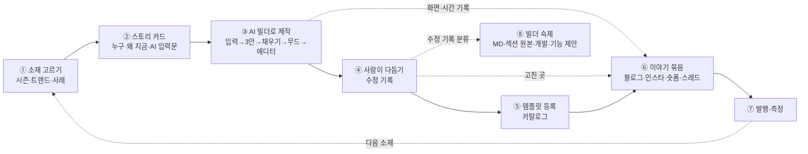

# 4-15. 시즌 템플릿 루프 — AI 빌더로 만들고, 이야기로 알리고, 빌더를 키운다

> 🎯 **한 줄** — **2주에 한 번**, 그 시기에 맞는 소재(명절·연말·트렌드)로 **AI 빌더가 템플릿을 만들고 사람이 다듬어 등록**한다. 만드는 과정을 전부 기록해 **템플릿마다 다른 이야기**로 알리고, 사람이 고친 곳은 **빌더의 숙제**로 넘긴다.
> 🔁 **원리 = 한 번 만들고 세 번 쓴다** — ① 카탈로그 템플릿 ② 마케팅 이야기 ③ 빌더 개선 재료.
> 📌 **상태 = 초안.** 승인 전에는 파일럿 2건만 돌린다 → [[#12. 정해 주셔야 할 것]].

---

## 0. 결론 먼저 — 5줄

1. **주기** = 월 1회 계획(승인 30분) + **격주 1개** 제작·발행. 파일럿에서 시간을 재 보고 안정되면 주 1개.
2. **소재** = 앞으로 8주 시즌 달력 + 트렌드 + 기존 사례 풀에서 고른다. 회차마다 **「이번에만 있는 새 것」 1개**(새 섹션·새 기능·처음 다루는 업종)가 있어야 신규 템플릿으로 낸다 — 없으면 기존 템플릿 활용 글로 돌린다.
3. **제작** = AI 빌더 실제 플로우를 처음부터 끝까지 돌린다(자동화 이미 있음). 사람이 다듬은 곳은 **「수정 기록」**으로 남긴다.
4. **이야기** = 블로그 새 시리즈 **「AI 빌더 제작기 #N」** 1편이 중심, 인스타·숏폼·스레드로 쪼갠다. **숫자는 잰 것만, 가상 인물은 가상이라고.**
5. **빌더 고도화** = 수정 기록을 4갈래(MD·섹션 원본·개발·기능 제안)로 나눠 기존 루프로 넘기고, **「사람이 고친 곳이 회차마다 줄어드는 것」 자체를 이야기로 쓴다.**

---

## 1. 목표와 성공 기준

| 목표 | 성공의 모습 | 재는 법 | 첫 3개월 목표 (제안) |
|---|---|---|---|
| ① **퀄리티 템플릿 가짓수** | 정해진 주기로 끊기지 않고 등록된다 | 등록 수 · 품질 점수(4-13 §2) | **6개 등록**(29 → 35) · 전부 80점+ · 비어 있는 카테고리 「소식·매거진」 첫 템플릿 |
| ② **AI 빌더를 실제 사례로 알린다** | 템플릿마다 다른 이야기가 나간다 | 발행 수 · 조회 → 템플릿 상세 방문 → 「사용하기」 (§9) | 이야기 6편 + 채널별 조각 |
| ③ (부차) **빌더 고도화** | 사람이 고치는 곳이 줄어든다 | 출고 전 수정 건수 · 넘긴 숙제 수 · 해결 수 (§8) | 회차별 추이 1장 |

> 🔑 세 목표는 따로 놀지 않는다 — ③이 좋아지면(고칠 곳 ↓) ①의 속도가 오르고, 그 변화가 ②의 이야기가 된다(「한 달 전과 같은 문장을 넣었더니」).

---

## 2. 전체 흐름

- **[[1-1. 워크플로우]]와의 관계** — 이 경로는 1-1의 1~3단계(기획 문서 → Claude Design 시안 → Figma 반입)를 **AI 빌더 한 번으로 대신**한다. 4~6단계(에디터 마무리 · 상세 페이지 · 어드민 등록)는 그대로 쓴다.
- **[[4-13. 데일리 퀄리티 루프]]와의 관계** — 4-13은 매일 밤 **가상 사례**로 빌더를 시험하고 새 섹션을 만든다. 이 루프는 격주로 **출고까지 가는 실전 사례**를 만든다. 4-13이 만든 새 섹션이 여기서 첫 실전에 나가고(§4-3), 여기서 나온 수정 기록이 4-13으로 돌아간다(§8).

---

## 3. 주기와 일정

### 3-1. 단계별 도입

| 단계 | 기간 | 주기 | 하는 일 | 다음 단계로 가는 조건 |
|---|---|---|---|---|
| 🧪 **파일럿** | 2026-11 | 2건 | 전 과정을 한 번씩 돌려 **회차당 시간·비용을 잰다**(`stamp.sh` 도장) | 2건 완주 + 사람 시간 실측 |
| 🌱 **정착** | 2026-12 ~ 2027-02 | 격주 1건 | 월간 계획 → 격주 발행 · 콘텐츠 묶음 정례화 | 3회 연속 일정 준수 + 전부 80점+ |
| 🚀 **확장** | 2027-03 ~ | 주 1건 검토 | 밤 무인 실행 검토 — `cdbd-daily-orchestrator`의 막혀 있던 2단계(Claude Design은 코드로 못 돌림)를 **AI 빌더 자동 실행(`s2js.sh`)으로 교체** | 회차당 사람 시간이 파일럿 대비 절반 이하 |

### 3-2. 한 회차 일정 (발행일 = D)

| 시점 | 할 일 | 산출물 |
|---|---|---|
| **D-14** | 소재 확정 · 스토리 카드 · 답변표(사실 칸 예시값) · 이미지 준비 | 스토리 카드 |
| **D-12** | AI 빌더 실행 — 전 과정 기록(§5-2) | 3안 캡처 · 단계 화면 · 시간 도장 · 화면 녹화 |
| **D-10 ~ D-7** | 다듬기 → 품질 관문 → 등록(OG · 모바일 스크린샷 · 상세 페이지 · 어드민 — 활성화는 보류) · **수정 기록을 분류해 그날 4-13 리포트로 넘긴다** | 템플릿(비활성) · 수정 기록 |
| **D-6 ~ D-2** | 이야기 묶음 제작 → 승인 | 블로그 초안 · 썸네일 · 캐러셀 · 숏폼 · 스레드 |
| **D** | **동시 발행** — 템플릿 활성화 + 블로그 + SNS | 발행 링크 |
| **D+14** | 측정 · 회고 1줄 | 회차 성적표 |

### 3-3. 발행 시점 — 「이벤트 날」이 아니라 「사용자가 만들기 시작하는 날」 기준

⏳ *(리서치 반영 예정)*

---

## 4. 소재 고르기

### 4-1. 후보가 나오는 곳

| 출처 | 무엇 | 어디 |
|---|---|---|
| 🗓 **시즌 달력** | 앞으로 8주 안의 명절·기념일·업계 시즌 | §10 (월간 계획 때 갱신) |
| 📈 **트렌드** | 그 시기 뜨는 소재·키워드 | §11 (월간 계획 때 갱신) |
| 🗂 **사례 풀** | 상황·페르소나가 이미 정리된 후보 | [[4-9-7. 모바일 페이지 제작 사례 20건]] — 시즌형이 이미 있다(#12 크리스마스 케이크 예약 · #1 야시장 · #8 수확 전 예약판매 · #18 성수기 대기 현황) · [[3-1. 신규 템플릿 18건]] 잔여 |
| 🆕 **새로 생긴 것** | 승인·등록된 신규 섹션 · 제품 신기능 | [[4-13. 데일리 퀄리티 루프]] 날짜 섹션의 「📚 등록 완료」 행 · [[_기능별 경로 가이드]] |

### 4-2. 다섯 질문 점수 — 각 0~2점 · 10점 만점 · **7점↑만 후보** · 동점이면 발행 마감이 급한 것 먼저

| 질문 | 2점 | 1점 | 0점 |
|---|---|---|---|
| ⏰ **타이밍** — 발행일이 그 소재의 「만들기 시작」 시점보다 앞서나 (§3-3) | 2주+ 앞 | 1주 앞 | 이미 늦음 |
| 🔍 **수요** — 찾는 사람이 있다는 근거가 있나 | 검색량·트렌드 자료 | 사례·정황 | 감 |
| 🆕 **새로움** — 「이번에만 있는 새 것」(4-3) | 2개+ | 1개 | 없음 |
| 🤖 **빌더 실증** — 한 단락 → 3안 · 자동 채우기 · 무드 같은 빌더 강점이 드러나나 | 뚜렷 | 보통 | 사람 손이 대부분 |
| 🗂 **카탈로그 공백** — 비어 있는 칸을 채우나 | 빈 카테고리 · 안 쓰인 카드 | 얇은 칸 | 이미 많은 칸 |

> 📊 **지금 비어 있는 칸**([[2-0. 전체 템플릿 개요]] · 29개 기준) — 카테고리 **소식·매거진 0 · 가이드·신청 1** · 카드 **상품 0**(코드 카드는 정책상 미사용이라 공백으로 치지 않는다).

### 4-3. 🔑 「이번에만 있는 새 것」 규칙 (필수)

**회차마다 아래 중 1개 이상이 완성본에 실제로 들어가야 신규 템플릿으로 낸다.**

- 🧩 **새 섹션의 첫 실전 투입** — 4-13에서 승인·등록된 섹션. 그 섹션이 **어느 레퍼런스에서 왜 생겼는지**가 4-13 날짜 섹션 행에 영구 보존돼 있어 그대로 이야기 재료가 된다.
- ⚙️ **제품 기능의 첫 활용** — 예: 예약 카드 QR 방문 체크 · 개별 URL(데이터 관리) · 멀티페이지 넘김 효과 · 내보내기
- 🏷 **처음 다루는 업종·주제** — 25주제 중 템플릿이 0개인 칸
- 🔀 **처음 쓰는 카드 조합** — [[3-1. 신규 템플릿 18건]]의 「NEW-PATTERN」 수준

**판정 = [[3-1. 신규 템플릿 18건]] §2.1 중복 5등급을 그대로 쓴다**

| 등급 | 처리 |
|---|---|
| 🟢 NEW · 🟡 NEW-PATTERN · 🆕 DEPENDENCY | 신규 템플릿으로 낸다 |
| 🟠 VARIANT | 위 「새 것」이 있을 때만 신규 · 없으면 ↓ |
| 🔴 OVERLAP | 신규 템플릿 ❌ → **「기존 템플릿 시즌 활용법」 글**로 낸다 (템플릿 수는 안 늘지만 카탈로그 중복을 막는다) |

> **왜** — 시즌 소재는 겉모습(색·문구)만 바뀌기 쉽다. 겉만 바뀐 템플릿을 늘리면 카탈로그가 비슷한 것으로 차고, 이야기도 매번 「AI로 빠르게 만들었어요」로 같아진다. **「새 것」이 곧 개별화의 재료다.**

### 4-4. 안전 체크 — 하나라도 걸리면 소재를 바꾼다

- 🚫 **비즈니스 범위 밖** — 개인 경조사·부고는 제외([[4-3. 목적·주제별 분류]] 1-3). 명절도 **사업 쪽으로**(설 선물 주문 ⭕ / 가족 모임 초대 ❌).
- 🚫 **사고·참사·정치·종교 갈등을 소재로** — 실무 안내(예: 태풍 임시휴무 공지)는 ⭕, 사건 자체를 홍보 재료로 쓰기 ❌.
- 🚫 **남의 상표·공식 명칭·캐릭터** — 국제 스포츠 대회의 공식 명칭·로고, 상표가 들어간 기념일 이름, 캐릭터·연예인 이미지 ❌ → 일반 표현으로(「연말 응원 이벤트」 · 「11월 11일 이벤트」).

---

## 5. 제작 — AI 빌더 경로

### 5-1. 단계

| # | 단계 | 하는 일 | 담당 | 도구 · 정본 |
|---|---|---|---|---|
| 1 | **스토리 카드** | 페르소나 · 상황 · **AI에 넣을 한 단락** · 답변표(사실 칸 예시값) · 이미지 | Claude 초안 → 사람 확인 | §6-1 양식 |
| 2 | **AI 빌더 실행** | 프리뷰 도메인 `/ai/create`에 그 한 단락을 넣고 끝까지(3안 → 채우기 → 확정 → 무드 → 에디터) | Claude (자동) | `s2js.sh` 「전부 채우기」 모드(`S2_ANSWERS`·`S2_IMAGES`) · `stamp.sh` · `fill-audit` · `editor-audit` — 사용법 = 4-13 `스크립트/README-s2.md` |
| 3 | **다듬기** | 에디터에서 출고 품질로 | Claude + 사람 | skill `cdbd-card-automation` · 수정 기록(§5-2) |
| 4 | **품질 관문** | §5-3 | Claude 채점 → 사람 승인 | 4-13 §2 · [[4-8. 시안 검수 체크리스트]] · [[4-9-5. 빌더 산출물 자동 스코어링 기준]] |
| 5 | **등록** | OG · 모바일 스크린샷 · 상세 페이지 · 어드민 | Claude (자동) → **활성화는 사람** | [[1-1. 워크플로우]] 4~6단계 · [[1-7. 템플릿 상세 페이지]] |

### 5-2. 기록할 것 — 이야기의 원재료 (빠지면 이야기를 못 쓴다)

| 기록 | 언제 | 어떻게 | 이야기에서 쓰는 곳 |
|---|---|---|---|
| **AI에 넣은 한 단락** + 첨부 | 실행 전 | 스토리 카드 | 「이 문장으로 시작했어요」 — 독자가 복사해 쓰게 |
| **3안 화면** | ⑥ 시안 선택 · **⑨ 확정 전에** — ⑨를 지나면 미채택 2안이 사라진다 | s2 캡처 | 3안 비교 |
| 내용 채우기 단계별 화면(입력 ↔ 미리보기) | ⑦ 단계마다 | `fill-audit` | 실시간 반영 장면 |
| 단계별 시각 | 전 과정 | `stamp.sh` → `timeline.tsv` | 「한 단락에서 3안까지 N분」 — **잰 숫자만** |
| **에디터 도착 첫 화면 = AI 원안** | ⑫ 직후 | `editor-archive` 캡처 | before |
| **수정 기록** | 다듬기 중 | 아래 표 | 「사람이 고친 3곳」 · 빌더 숙제 |
| 완성 화면 | 등록 직전 | 모바일 스크린샷 | after |
| 화면 녹화 | 빌더 실행 중 | 1~2초 간격 프레임 → ffmpeg 합성(4-13 §1 P 레시피) | 숏폼 원본 |

**수정 기록 양식** (회차 폴더에 1장)

| # | 어디(섹션·카드) | AI가 낸 것 | 바꾼 것 | 왜 | 갈래(§8-1) | 넘긴 곳 |
|---|---|---|---|---|---|---|

### 5-3. 품질 관문 — 전부 통과해야 등록

- [ ] **0층 게이트 FAIL 0** — 재현 불가 · 대비 미달 · 사실 창작 · `editor-audit` 치명 C (4-13 §2)
- [ ] **루브릭 80점+** — 디자인 60 + 내용 40 (4-13 §2)
- [ ] **[[4-8. 시안 검수 체크리스트]] 전수 스윕 결함 0**
- [ ] **「이번에만 있는 새 것」이 완성본에 실제로 들어 있다** (§4-3)
- [ ] **사람 최종 승인** — 모바일 프리뷰를 통째로 보고

### 5-4. 지킬 것

- 🔒 **같은 계정 동시 사용 금지** — CdBd는 계정당 활성 세션이 1개다. 4-13 밤 런(20:00~)과 겹치지 않게 **낮에** 돌리고, 시작 전에 다른 세션이 비었는지 확인(4-13 §0-6 · `README-s2.md` 7).
- 🔒 **사실 칸(일시·가격·연락처·계좌)은 스토리 카드 답변표에 우리가 정한 예시값만** — 빌더가 지어내면 그건 **빌더 결함으로 기록**한다(§8).
- 🔒 **자동화가 산출물을 바꾸는 우회를 했으면 그 회차의 원안은 「AI 원안」으로 쓰지 않는다**(4-13 §0-9) — 이야기에서도 채점에서도.
- 💰 **비용** — 빌더 생성은 크레딧 차감 예정([[컨텍스트: 이선호/2026-10-21 AI 빌더 무료 크레딧 체험 정책·모달 시안]]) · 발행(URL 생성)은 과금 → 회차당 비용을 파일럿에서 잰다.

---

## 6. 이야기 만들기

### 6-1. 스토리 카드 — 회차마다 1장 (이게 곧 블로그·SNS의 뼈대)

| 칸 | 채울 것 | 예 — 「크리스마스 케이크 예약」 후보 |
|---|---|---|
| ① **왜 지금** | 시즌·트렌드 한 줄 + 근거 | 12월 첫 주부터 케이크 예약 전화가 몰린다 |
| ② **누구의 무슨 상황** | 페르소나 · 문제 (**가상임을 표기**) | 동네 베이커리 사장님(가상) — 픽업 시간이 겹쳐 매장이 붐빈다 |
| ③ **AI에 넣은 한 단락** | 원문 그대로 | (실행 때 확정) |
| ④ **AI가 만든 3안** | 무엇이 달랐나 1줄씩 | (실행 후) |
| ⑤ **사람이 고친 곳** | 수정 기록 상위 3개 — **AI가 틀린 것도 숨기지 않는다** | (다듬기 후) |
| ⑥ **이번에만 있는 새 것** | 새 섹션(어느 레퍼런스에서 배웠나) / 새 기능 / 새 조합 | 예약 카드 = 픽업 시간대 · 지점별 안내 |
| ⑦ **내 것으로 바꾸는 법** | 바꿀 곳 3군데 + 다른 업종 응용 1개 | 꽃집 → 발렌타인 꽃다발 예약 |

### 6-2. 이야기 각도 — 회차마다 주 각도 1개 · **직전 2회와 같은 주 각도 ❌**

| 각도 | 제목 틀 예 | 쓰는 때 |
|---|---|---|
| 🗓 **시즌** | 「크리스마스 케이크 예약, 전화 대신 페이지 하나로」 | 발행 시점 창 안(§3-3) |
| 📈 **트렌드** | 「{유행 소재} 멤버 모집 페이지, 한 단락으로 시작하기」 | 트렌드 근거가 있을 때 |
| 🧩 **새 섹션** | 「해외 베이커리 사이트에서 배운 지점 안내」 | 새 섹션 첫 투입 |
| ⚙️ **새 기능** | 「예약 카드 QR 방문 체크로 입구 줄 없애기」 | 기능 첫 활용 |
| 🔧 **비하인드** | 「AI가 처음 만든 3안과 우리가 고친 3곳」 | 수정 기록이 흥미로울 때 |
| 📊 **성장 일지** | 「한 달 전과 같은 문장을 넣었더니」 | §8-3 재실행 결과가 있을 때 |
| 📘 **가이드** | 「설 선물 주문 페이지, 3곳만 바꾸면 내 가게 것」 | 상시 (검색용) |

> 🔑 **개별화 = 「각도 × 소재 × 새 것」 조합.** 같은 각도라도 소재·새 것이 다르면 다른 이야기다. 셋이 다 직전 회차와 겹치면 각도를 바꾼다.

### 6-3. 콘텐츠 묶음 — 회차 1번 = 아래 한 세트

⏳ *(리서치 반영 예정 — 채널 우선순위)*

### 6-4. 블로그 「AI 빌더 제작기」 틀

지금 블로그는 **「[실제 이용사례 #N]」 시리즈**(#12까지 · 질문형 소제목 + FAQ + 템플릿·랜딩 페이지로 가는 버튼 · 예: #11은 약 8,500자)가 주력이다([home.cdbd.in/blog](https://home.cdbd.in/blog) · 2026-10-29 확인). 새 시리즈는 **같은 뼈대를 쓰고 소제목만 고정**한다 — 독자가 시리즈를 알아보고, 우리는 매회 빈칸만 채운다.

1. 왜 지금 {소재} 페이지가 필요할까요? ← 스토리 카드 ①②
2. AI에게 무엇을 입력했나요? ← ③ (**복사용 상자**로)
3. AI가 만든 3안은 어떻게 달랐나요? ← ④
4. 사람은 어디를 고쳤나요? ← ⑤
5. 이번에 새로 들어간 {섹션/기능}은 무엇인가요? ← ⑥
6. 내 가게에 맞게 바꾸려면? ← ⑦
7. 자주 묻는 질문 (3~5개)
8. 버튼 — 「이 템플릿 열어보기」 · (빌더 공개 후) 「AI로 내 버전 만들기」

- 제목 = `[AI 빌더 제작기 #N] {소재} — {부제}` (기존 시리즈 표기와 짝)
- 썸네일 = 마케팅 볼트의 **블로그 썸네일 자동 생성**(입력 = 타이틀 + 시리즈 부제 `AI 빌더 제작기 #N`) → `cdbd-marketing/블로그/썸네일/0. 목표와 비전.md`
- 게시 = 마케팅 볼트에서 쓰는 **Wix 연동**으로 초안 등록 → 승인 → 게시 (`cdbd-marketing/홈페이지/Wix 작업 가능범위.md`)

### 6-5. 정직·법 규칙 (필수)

- 🔢 **숫자는 잰 것만** — 제작 시간 = `stamp.sh` 도장, 수정 건수 = 수정 기록. 「전환율 40%↑」 같은 근거 없는 성과 ❌ (4-13 §0-12와 같은 원칙).
- 🙋 **가상 인물은 가상이라고 밝힌다** — 스토리 카드의 페르소나·AI 생성 인물 사진을 실제 고객·후기처럼 쓰지 않는다. 공정위 「추천·보증 심사지침」 개정으로 **AI 가상인물을 내세운 광고는 「가상인물」 표시가 의무**다(2026-04 행정예고 → 2026-06-01 시행으로 보도 · [디지털데일리](https://www.ddaily.co.kr/page/view/2026040811563569528) · [로톡 정리](https://www.lawtalk.co.kr/posts/156115)).
- 🤖 **「AI가 다 했다」 ❌ → 「AI 초안 + 사람 손질」** — 고친 곳을 숨기지 않는다. 그게 오히려 신뢰 재료다.
- 🖼 **AI 생성 이미지는 캡션에 「AI 생성」 표기** — AI 기본법(2026-01-22 시행)의 생성물 표시 의무는 **AI 서비스를 제공하는 사업자** 몫이고, AI 이미지를 마케팅 소재로 쓰는 쪽은 원칙적으로 대상이 아니다([뉴시스](https://www.newsis.com/view/NISX20260121_0003485509)). 그래도 표기하는 편이 신뢰에 유리하다. ⚠️ **단 AI 빌더 자체는 「고객이 AI를 쓰는 서비스」라 다르다** → §12-8.
- ©️ **레퍼런스 사이트 캡처는 공개 콘텐츠에 싣지 않는다** — 「어디서 배웠는지」는 이름·링크로만 밝히고, 보여 주는 건 우리 섹션이다.

---

## 7. 채널과 발행

⏳ *(리서치 반영 예정)*

---

## 8. 빌더 고도화로 잇기

### 8-1. 수정 기록 4갈래 (+ 취향) — 가르는 법은 4-13 §0-8 · §1 S2 그대로

| 갈래 | 이런 때 | 넘기는 곳 |
|---|---|---|
| 📝 **MD 몫** | AI가 정하는 것(질문·문구·섹션 선택·무드)이 틀렸고, 활성 MD에 그 규칙이 **없다** | 그날 4-13 리포트 게이트 2 → MD 개정 → **어드민 업로드·활성화까지** |
| 🔧 **개발 요청** | 활성 MD에 규칙이 **있는데** 또 나온다 · 화면·저장·변환 결함 | 4-13 리포트 「🔧 개발 요청」 — 증거 캡처 필수(4-13 §0-8) |
| 🧩 **섹션 원본 몫** | 섹션 자체의 여백·구조 문제 | 섹션 원본 수정 — Figma 원본도 같이([[4-5. 섹션 라이브러리]]) |
| 💡 **기능 제안** | CdBd에 기능이 없어 우회했다 | [[4-14. 기능 제안 (CdBd 제품)]] 「막힌 사례」 |
| 🎨 **취향** | 결함이 아니라 우리 취향 손질 | **넘기지 않는다** — 기록만 (한 번의 취향을 규칙으로 일반화 ❌) |

### 8-2. 지표 2개 — 회차마다 기록 → 월간 추이

- **출고 전 수정 건수** — AI 원안에서 등록 가능한 품질까지 고친 곳 수(취향 제외). **줄어야 한다.**
- **AI 원안 생존율** — 카드 기준, 손대지 않고 그대로 나간 카드의 비율. **올라야 한다.**

> 두 숫자의 추이가 그대로 「📊 성장 일지」 이야기가 된다. 단 **잰 숫자만** 쓴다(§6-5).

### 8-3. 같은 문장 다시 돌리기

회차의 「AI에 넣은 한 단락」을 **4~6주 뒤 그대로 다시 넣어** 원안을 비교한다. 4-13 S2의 「같은 입력 재현 검증」 자리(런당 1건까지)를 쓴다 → **개선 확인 + 📊 성장 일지 콘텐츠**를 한 번에 얻는다.

### 8-4. 섹션 수요 신호 → 4-13 리서치로

만들다가 **「필요한데 서랍에 없는 섹션」**이 나오면 그 업종·주제를 **4-13 R의 쿼리 로테이션**에 넣는다. 다음 시즌 소재가 정해지면 **미리** 넣는다(예: 설 회차 6주 전 → 선물세트 주문 레퍼런스). 그렇게 만든 섹션이 다음 회차의 「🧩 새 섹션」이 된다 — **두 루프가 서로의 재료를 댄다.**

---

## 9. 측정

| 층 | 지표 | 어디서 | 지금 상태 |
|---|---|---|---|
| 콘텐츠 | 조회 · 저장 · 공유 | 각 채널 기본 통계 | 바로 가능 |
| 유입 | 콘텐츠 → 템플릿 상세 방문 | 링크마다 **UTM 꼬리표**(어느 글에서 들어왔는지 붙이는 표시) — `utm_source={채널}` · `utm_campaign=season-{회차번호}` | CdBd에서 볼 수 있는지 **확인 필요**(§13) |
| 전환 | 「템플릿 사용하기」 클릭 · AI 빌더 시작 · 첫 발행 | CdBd 내부 데이터 | **확인 필요**(§13) |
| 품질 | 루브릭 점수 · 출고 전 수정 건수 · 원안 생존율 | 우리 기록 | 바로 가능 |
| 빌더 | 넘긴 숙제 수 · 해결된 수 | 4-13 리포트 | 바로 가능 |

- **월간 회고 1장** — 회차별 성적표(표 1개) + 다음 달에 바꿀 것 3줄. 회고 문서 위치 = 이 문서 옆 `4-15 회고/YYYY-MM.md` (파일럿 끝나고 만든다).

---

## 10. 첫 3개월 일정표

⏳ *(리서치 반영 예정 — 시즌 달력)*

---

## 11. 리서치 요약 — 2026-10-29

⏳ *(리서치 반영 예정)*

---

## 12. 정해 주셔야 할 것

1. **주기** — 격주 1개(추천 · 파일럿 실측 후 조정) / 주 1개
2. **AI 빌더 공개 전 노출 범위** — ⓐ 공개 전엔 「AI로 만든 템플릿」이라는 사실만 알리고 이야기는 **비축**(공개 때 사례 여러 편을 한꺼번에) ⓑ 지금부터 「곧 공개」 예고 + 사전 신청 ⓒ 공개 후 시작
3. **「AI 빌더로 제작」 표시** — 템플릿 상세 페이지에도 넣을지
4. **역할** — 블로그 게시·썸네일(마케팅 볼트 파이프라인) · 인스타·스레드 계정 운영을 누가 맡는지
5. **예산** — 빌더 생성 크레딧(차감 예정) · 예시 페이지 게시 크레딧 · 이미지 생성
6. **「사용 성과」 칸** — 신규 템플릿엔 실사용 데이터가 없다 → 잰 사실(예: 「한 단락 입력으로 시안 3안」)로 쓸지, 데이터가 쌓일 때까지 다른 칸으로 대신할지 ([[1-7. 템플릿 상세 페이지]] 「사용 성과」는 수치를 권장하지만, 근거 없는 수치는 §6-5와 충돌)
7. **파일럿 2건 소재** — §10 후보 중
8. (확인) **AI 빌더 자체의 AI 기본법 의무** — 빌더는 고객이 AI를 쓰게 하는 서비스라 「AI 이용사업자」의 고지·생성물 표시 의무가 걸릴 수 있다(계도기간 중 — 과태료는 빨라도 2027년 이후 전망). 빌더를 공개 마케팅하기 전에 **법무 확인 권장**.

---

## 13. 🔧 개발 요청 · 💡 기능 제안 후보

**🔧 개발 확인 요청** — 점검 3범위
- ⓐ **찾은 결함** — 없음 (아직 실행 전 · 파일럿에서 나오면 그날 4-13 리포트로)
- ⓑ **이 계획이 돌아가려면 필요한 것** — ① 템플릿 상세 페이지 방문과 「템플릿 사용하기」 클릭을 **들어온 경로(UTM 꼬리표)별로 볼 수 있는지** ② AI 빌더 시작·첫 발행이 **어느 경로로 들어온 사람인지** 볼 수 있는지 — 안 되면 목표 ②를 숫자로 못 잰다
- ⓒ **자동으로 채워야 하는 재료** — 내용 채우기의 빈 이미지 칸 AI 생성 → **이미 전달됨**(10-26 리포트 D-1 · 중복 ❌)

**💡 기능 제안 후보** — 승인 시 [[4-14. 기능 제안 (CdBd 제품)]]로 옮긴다
- **「이 템플릿처럼 AI로 만들기」** — 템플릿 상세에서 AI 빌더를 그 템플릿의 입력 한 단락으로 미리 채워 시작한다. 콘텐츠를 본 사람이 **같은 화면에서 바로 체험**으로 넘어간다.
- **시즌 모음** — 템플릿 갤러리에 기간 한정 묶음(예: 「연말 시즌」)
- **템플릿 상세에 「제작 이야기」 링크 칸** — 블로그 글로 연결

---

## 이력

| 날짜 | 바뀐 것 |
|---|---|
| 2026-10-29 | 초안 작성 (이선호 요청 — AI 빌더 제작 템플릿을 시즌·트렌드 소재로 정기 제작 + 템플릿별 개별화 스토리 마케팅 + 빌더 고도화) |
